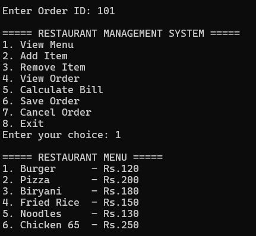
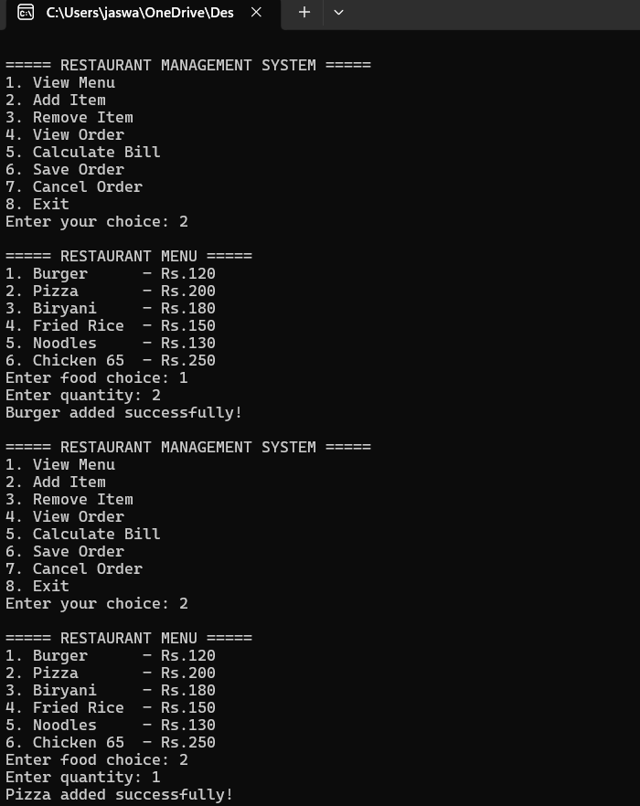
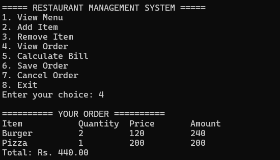
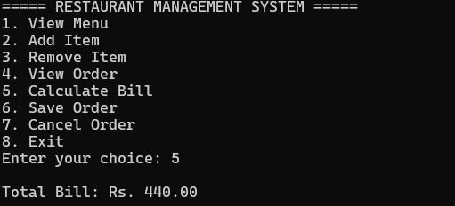
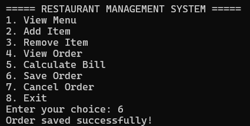

# Restaurant Management System

A console-based Restaurant Management System written in C++. It lets a user view the menu, place an order, manage items, calculate the bill and save the order to a CSV file.

## Features
- View the restaurant menu
- Add items to the order
- Remove items from the order
- View the current order
- Calculate the total bill
- Save the order to `orders.csv`
- Cancel the current order
- Input validation

## Technologies Used
- C++ (STL: vector, fstream, iomanip)
- Concepts: classes, structures, file handling, input validation

## How to Run
Compile and run using these commands:

    g++ restaurant.cpp -o restaurant
    ./restaurant

On Windows, run `restaurant.exe` instead of `./restaurant`.

## Project Files
- `restaurant.cpp` : Source code
- PPT : Project presentation
- Screenshots : Project implementation / output
- Demo video : See the link below

## Screenshots
### Menu

### Add Item

### View Order

### Bill

### Save Order

## Demo Video
Demo video link: PASTE-YOUR-VIDEO-LINK-HERE

## Author
jaswanthikuramsetti-a11y
